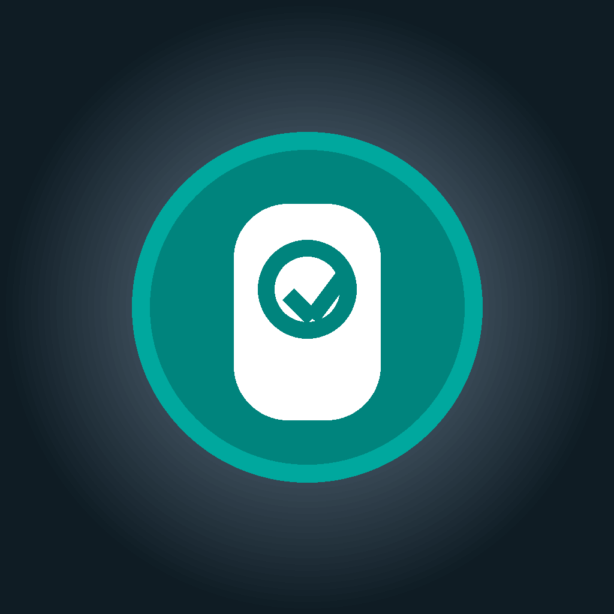

# Olo

**Открытый VPN‑клиент** с крупным понятным интерфейсом (в духе Shadowrocket). Код Shadowrocket не используется.

Туннель на всех платформах: движок **[sing-box / Libbox](https://github.com/SagerNet/sing-box)** (GPL‑3.0).

<p align="center">
  
</p>

## Матрица платформ

| Платформа | UI | Туннель | Статус |
|-----------|----|---------|--------|
| **Apple** (iPhone / Mac) | SwiftUI | Network Extension + Libbox | UI + импорт готовы; P0: Reality/HY2, Keychain, честный статус NE |
| **Android** | Kotlin + Jetpack Compose | `VpnService` + Libbox `.aar` | MVP scaffold: UI, парсеры, сервис, генератор JSON |
| **Windows** | .NET 8 + Avalonia | `sing-box.exe` (mixed / TUN) | MVP scaffold: UI, импорт, runner |

Общий формат серверов: [`core/docs/server-json.md`](core/docs/server-json.md).

## Roadmap

### P0 — блокеры реального VPN
- [x] Apple: Reality (`pbk`/`sid`/`fp`/`flow`), HY2 obfs в builder + ручная форма
- [x] Apple: секреты в Keychain
- [x] Apple: без тихого демо‑подключения при ошибке NE
- [ ] Apple: подпись Network Extension + App Group `group.app.olo.vpn`, e2e на устройстве
- [ ] Android: подключить собранный `libbox.aar` к `OloVpnService`
- [ ] Windows: e2e с WinTun / system proxy на реальной машине

### P1 — продукт
- Живой монитор (Clash API / события Libbox)
- geoip/geosite rule-set
- Авто‑refresh подписок
- Иконки Mac 512@1x/@2x; логи extension в App Group

### P2 — позже
- Widget / Menu Bar / Control Center
- App Store vs GPL (вне Store или другой движок)

## Структура репозитория

```
OloVPN/          Apple UI + сервисы
PacketTunnel/    Network Extension (Libbox)
android/         Compose app (Gradle)
windows/         Avalonia .sln (Olo.Desktop)
core/docs/       спецификация JSON сервера
scripts/         fetch Libbox / AAR / sing-box Windows
```

## Быстрый старт

### Apple

```bash
./scripts/fetch_libbox.sh
brew install xcodegen   # если ещё нет
xcodegen generate
open OloVPN.xcodeproj
```

Схемы: **OloVPN** (Mac), **OloVPN-iOS** (iPhone). Нужен Apple Developer: Network Extensions + App Group `group.app.olo.vpn`.

### Android

```bash
# опционально собрать Libbox AAR:
./scripts/fetch_libbox_android.sh

cd android
./gradlew :app:assembleDebug
```

Откройте `android/` в Android Studio. Min SDK 26. Без `libbox.aar` поднимается TUN‑заглушка и пишется `sing-box-config.json`.

### Windows

```bash
./scripts/fetch_singbox_windows.sh
cd windows
dotnet build Olo.sln   # .NET 8+ / 10 SDK
dotnet run --project Olo.Desktop
```

По умолчанию — mixed proxy `127.0.0.1:7890` (без админа). Опция TUN — с правами администратора и WinTun.

### Автотесты

```bash
./scripts/run_vpn_tests.sh
```

Проверяет: unit‑тесты парсеров/builder (Windows + Android), `sing-box check` + живой smoke через local mixed→direct proxy, сборку Apple macOS. Полный e2e туннель с вашей нодой — отдельно (подпись / Libbox / WinTun).

## Возможности (общие)

| | |
|---|---|
| **Серверы** | Универсальный импорт: `ss` · `vmess` · `vless` · `trojan` · `hy2` · `tuic` · `socks` · `wg` · HTTP‑proxy; пачка ссылок; https‑подписки (URI / Clash JSON / sing-box JSON) |
| **Маршрут** | Умный / весь трафик; местные домены региона мимо VPN |
| **Защита** | Kill switch, DNS через VPN, блок IPv6, LAN |

## Лицензия

**[GPL‑3.0-or-later](LICENSE)** — совместимо с sing-box. App Store и GPL стыкуются плохо; логичный путь сейчас — GitHub / TestFlight / прямая установка.

## Благодарности

- [sing-box](https://github.com/SagerNet/sing-box) — ядро прокси  
- Открытые клиенты на Libbox — паттерны туннеля  
